## Swiss or Sliding?

Today I got to play with a Nomura Sliding Head CNC with a Mitsubishi 60s control.

You know that feeling when you’re stood in the middle isle at Aldi holding a 40mm drill that’s about a meter long and you’re trying to convince yourself that you need it cos it’s only £4.99?

Well that sums up my relationship with this NOMURA CNC sliding head machine. I fuckin want one. My Mrs would never agree to it, she won’t even let me have a soddin’ 60″ TV so I think I have a “dogshit in hells” chance of a Swiss Auto CNC.

## Nomura Sliding Head, Mitsubishi 60s

It’s always a bit strange working on a CNC sliding head machines after working on standard CNC Lathes.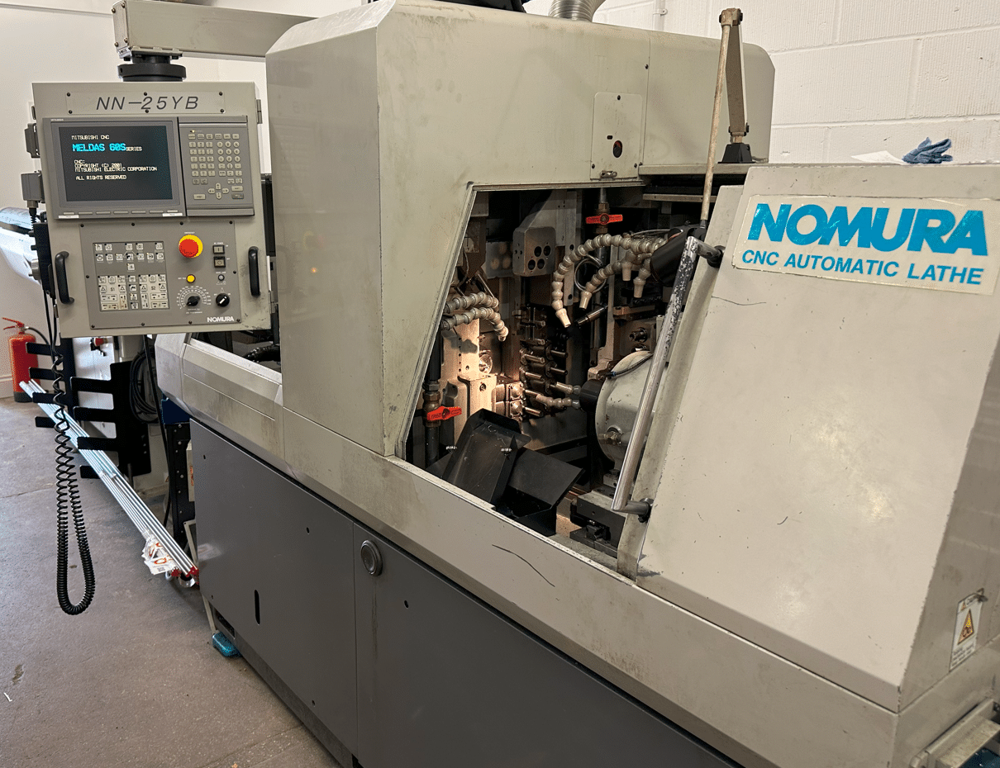

This one has the Mitsubishi 60s control, it’s quite old but still capable of producing some amazing parts and pretty dam fast too.

The control is really good in some ways but a bit shit in others, like no copy n paste. The actual day to day editing is precarious and scary in equal measures until you get used to it.

My advise as usual is to [back up all your programs](https://youtu.be/gV63DLDOSxo) and copy the one you are working on. Oh, and don’t forget it’s easy to take a picture of the screen.

For my older viewers, you don’t even have to get your pictures developed any-more.

On this control it is so fuckin easy to overwrite or delete the code and even to delete the whole block!!

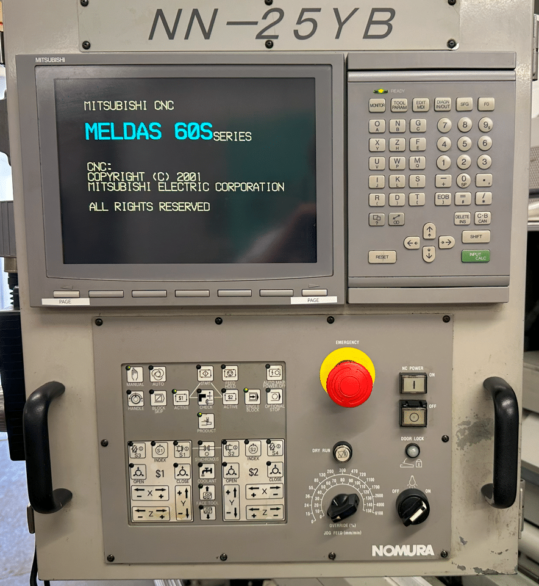

Mitsubish Meldas 60S control. All knocking on a bit but loads of fun and really useful.

## What’s A Swiss Machine?

Well it’s a bit like a Swiss Roll except you can’t eat it.

Now if you know nothing about sliding head CNC machines, Swiss machines, as they are sometimes known here is a brief lesson.

On a sliding head machine your tools are static with regards to the Z axis. For Z movements your material moves through a guide bush. The collet is behind this and the Z axis pushes the material back and forth through the guide bush.

This means you can do shit that you can’t do on a normal lathe. Like making watches, A sliding head is worth buying just to knock out a coupe of Rolex watches to sell on Ebay (good idea what)

This is how [Kingsbury](https://kingsburyuk.com/multi-spindle-vs-sliding-head-lathes/#:~:text=Sliding%20head%20lathes%20are%20well,drilling%20or%20even%20milling%20operations.) describe them on their website

_Sliding head lathes are well suited to long, thin and complex parts with large production runs. Parts with a length to diameter ratio of 20:1 can be manufactured on these machines. In addition to this, multiple live tools can be set up to allow for drilling or milling operations. Sliding head lathes can engage the material with several tools at once, improving productivity and enhancing the potential to reduce the number of costly set-ups._

## Nomura Sliding Head CNC

Tooling arrangements are not like a normal lathe they are usually in a rack which moves up and down. The length of the tools is tightly controlled so they tend to be mostly of a fixed length.

You are supplied with a pre-setting fixture so you can set the tools to standard lengths and use offsets accordingly.

You can mill and drill with both rotary and static tools. This one has a sub spindle so it picks up the part and then machines the back end before ejecting it onto a chute.

I must admit they can scare the living shit out of most people. It’s well worth taking the time and patience to learn how to program and set these beasts. Complex yes but even I can do it, and so much fun and you get to keep your underpants on.

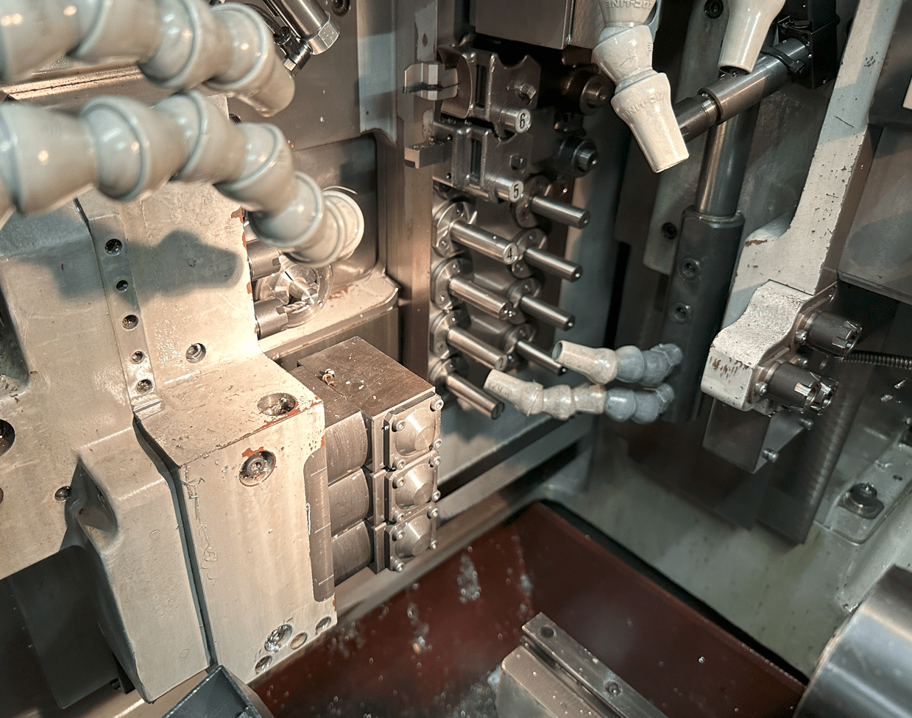

This thing is armed to the fuckin teeth, it’s the Arnold Schwarzenegger of CNC machines. Well equipped, more tools than the middle isle at Aldi.

Sorry to keep talking about this but I only just discovered it (middle isle at Aldi that is).

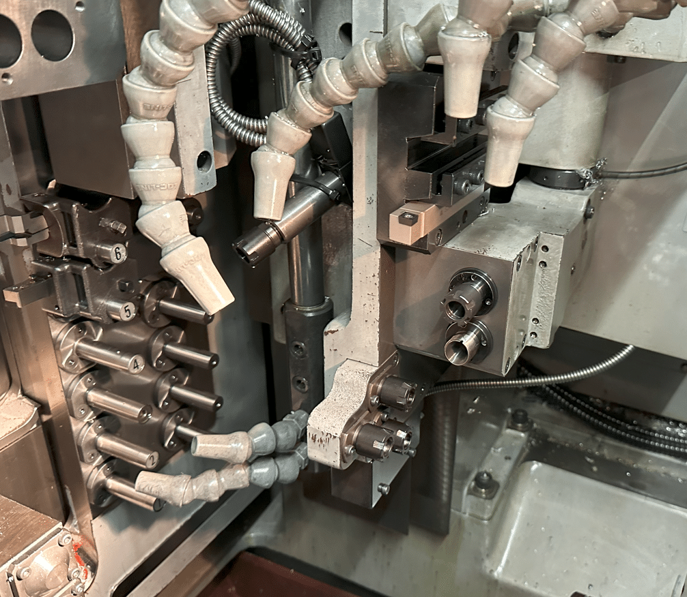

## Mitsubishi 60s CNC Control

Switching on is easy, you just do it, having absolute encoders means you don’t need to reference it.

[If you really must](https://youtu.be/omg7ZnZ5s-8) then just press SHIFT then F0 that’s F 0 as in fuck off (good way to remember it)

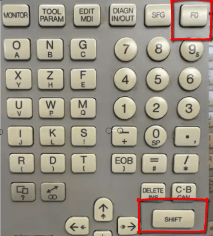

Here is a picture for my readers who don’t like offensive language like bollocks and stuff.

Then on the next screen just input your axis of choice.

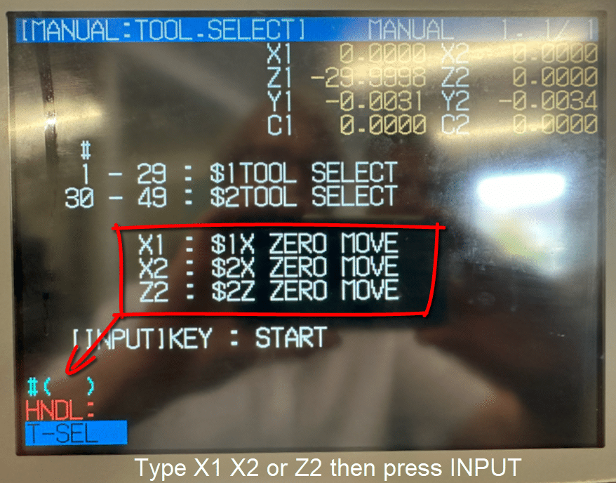

You will notice you can’t zero all axis from here just the **X2** and the **Z2** at the back. That’s the spindle below.

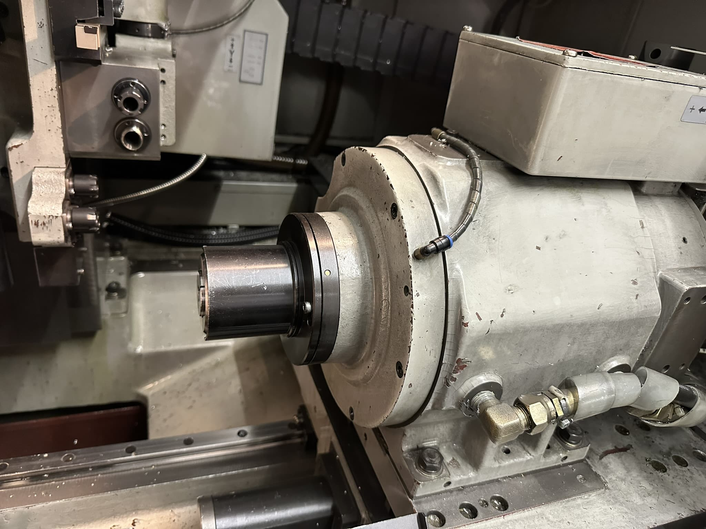

And the **X1** which is your tool platen.

Actually you can zero return any axis if you go into MDI unfortunately this involves more pages than the extended edition of war and peace. A nice little book by Leo Tolstoy, he’s like a sort of Geoffrey Archer if he’d turned up for school.

Once you start to get into it, it definitely is more simple than it first appears, so is “War and Peace” for that matter.

## Tool Change Nomura Sliding Head

From this same screen remember SHIFT F0 you can input a tool number. Just type it in that box #(  )

Be careful because as soon as you hit INPUT CALC it moves and when I say it moves it’s fast.

Good idea is to retract the bar well back level with the front of the guide bush. That way there’s nowt to hit as we say up north.

[Here’s a nice video.](https://youtu.be/omg7ZnZ5s-8)

## Hand-Wheel Nomura Sliding Head

It has a hand-wheel just like a normal CNC and you can select your axis. First select the spindle 1 or 2 then the axis you want to move. You’ll also need to pick the increment

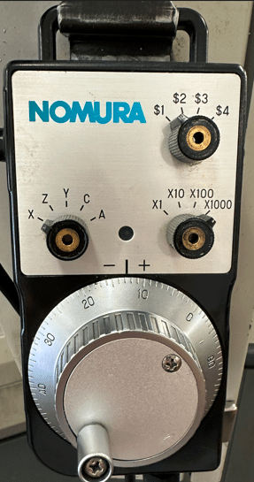

Oh and you need to keep the black button at the side pressed in at all times. This is so you don’t get up to any mischief like trying to scratch your arse or bollocks whilst moving the machine around.

[This video shows you how.](https://youtu.be/Ol7zeLLAIYc)

(Sorry for any confusion it shows how to do the latter not the former.)

Jogging around is quite simple, just use these blighters.

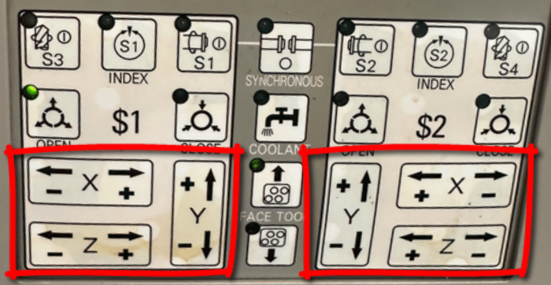

This potentiometer will control the speed of the movement. Start with it wound well down.

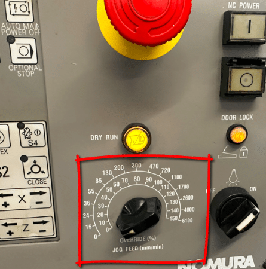

This machine has a strange quirk which is when you over travel the rear Y axis you have to shut down the machine and throw a switch before it will let you wind it back in.

Very annoying so it’s best to use jog instead of hand wheel. That way you can easily see the correct direction. Even better use zero return if you just want the little buggers out of your way.

It has axis direction plates stuck up everywhere so use em.

## Start Spindles, Nomura Sliding Head

On this machine you have loads of spindles. To set a speed you need this screen, press MONITOR then soft key POSI

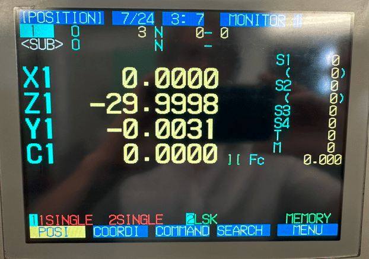

Each time you press the S key it will move down the different spindles so you can input a speed.

[YouTube video](https://youtu.be/8VzqRNm-gOU)

## MDI, Nomura Sliding Head

MDI is weird on this machine and so awkward to use it renders it fuckin useless that is unless like me you train people for a living. Obviously then it’s worth showing them so they think “Fuck, what a clever bastard. Fancy knowing that piece of useless information”

## So I’ll Show You Anyway

First of all press monitor

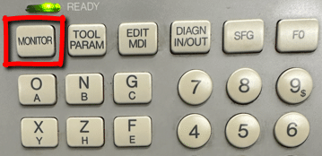

Then press the soft key PLC-SW you will also need to press the page key if you are not on page 2.

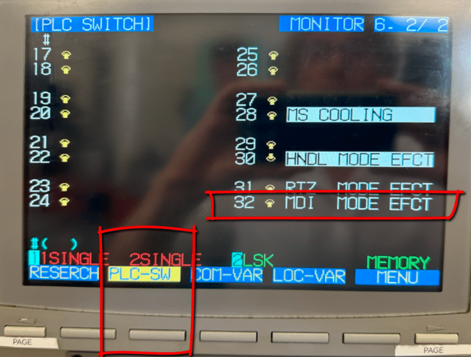

You will notice that 32 MDI MODE EFCT is not shaded in blue, this means it is off. Type in 32 and this will toggle the switch thus turning it on **#(32)**

Screen will now look like this, notice switch is thrown and a blue line appears. Up is off, down is on mmm strange.

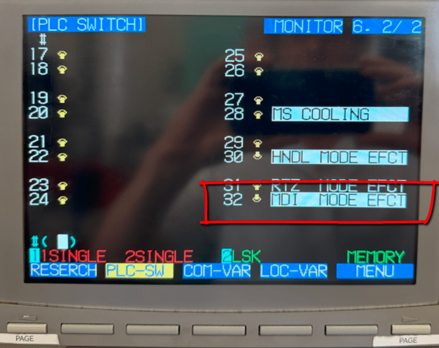

Unfortunately all you can now do is run MDI commands, if you want to run or edit a program you will need to reverse this by re typing 32 into the box again.

Press your EDIT MDI button to get to the MDI page.

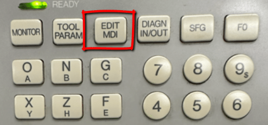

As you type in commands you can press cycle start to run them.

Phew…….

## This is Amazing, Mitsubishi 60s

Right so, MDI is fuckin daft to put it mildly and it has a self district button but and a massive but. It can do something truly amazing. What is it you ask?

Let me say now if you already have this control prepare to be amazed and utterly ashamed of yourself for not knowing in equal measures.

Now I know your saying “this silly old twat is really dragging this out”. Actually I’m not so you can piss off.

You know when you are running a program and you think “shit I forgot to alter that bloody feedrate”.

Help is at hand, no need to reset and start again no no no.

All you do is switch to Edit and the next few lines are all highlighted and you are allowed to alter the program. When you switch back to Memory mode it just carries on.

How cool is that editing on the fly.

Don’t you just love flies.

## Tool-Change (In Program)

When you call out a tool in a program everything is taken care of.

Say for example you wanted tool 6 in this case it’s my parting off tool.

**Y#506 T0606**

This calls the offset for tool 6 and the Y looks into **#506** and moves down to the correct position.

The rack of tools moving up and down is your Y axis so in **#506** it stores that Y position. Oh yea and it conveniently moves X back out of the way too. This is because it is also reading the X offset.

The sliding head principle is that your bar which is usually ground is held at the back in a collet it then slides into a guide bush which is where the action takes place. It means that you can machine very long parts without the need for a centre to support it.

The accuracy of the bar size to the guide bush is obviously quite important. THe guide bush is adjustable but it won’t know if your bar size varies.

This one has a main spindle and it has a sub spindle. Meaning there are two programs running together. [To switch channels](https://youtu.be/zlP4aHe2T38) just press EDIT then SHIFT then either 1 or 2 for which channel you want.

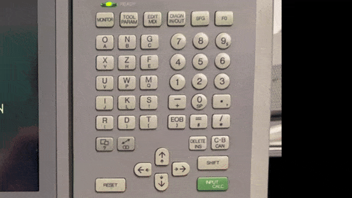

## Both Programs

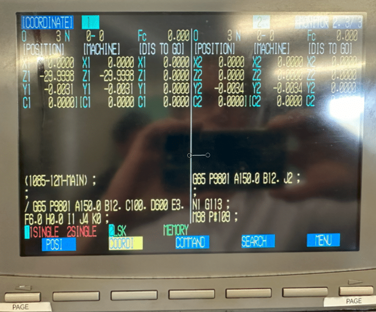

Press soft key COORDI then right hand page key until you see both programs, this is useful to know what is going on with both programs.

## Editing

It has an easy program copy function press MONITOR

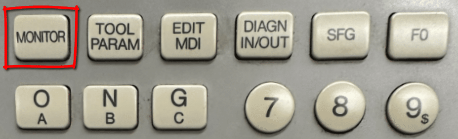

Then the soft key MENU then you will find a soft key COPY.

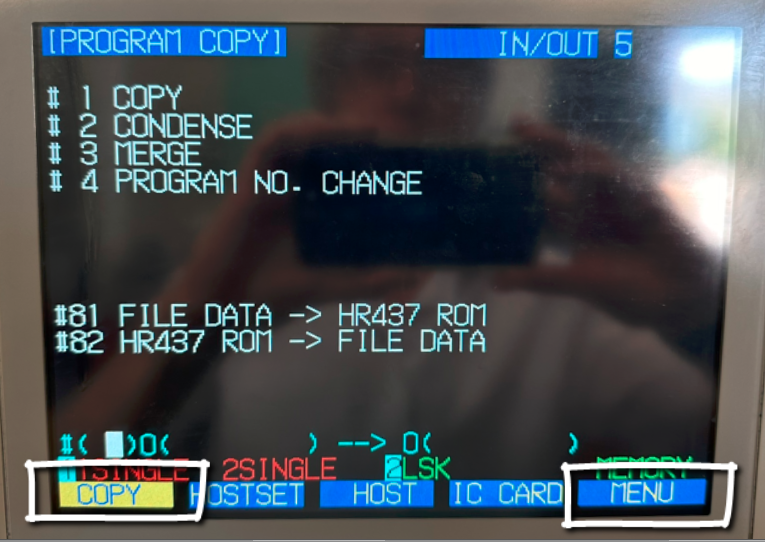

Enter a 1 in **#(1)** followed by the program you want to copy and the new program number.

The number 1 tells it you want to copy a program.

[Useful video link](https://youtu.be/SmUsGpC3kM4)

See below to copy program **123** to program **234**

If you type 4 in the first box you can use it to change a program number. Below would change program number 123 to program 234

As you can see above changing the program number is easy too. If you are used to [Fanuc programming](https://www.cnctrainingcentre.com/fanuc-editing-copy-and-paste/) then you will know that some of this stuff is not always easy. This control will come as a bit of a shock to the sytem as it works in a very different way.

## Altering The Code, Insert Alter Delete

Unlike Fanuc the Mitsubishi 60s control automatically overwrites the code that’s already in. I found this very stressful to a point that I always copy my program before changing anything.

To insert code first press DELETE INS key

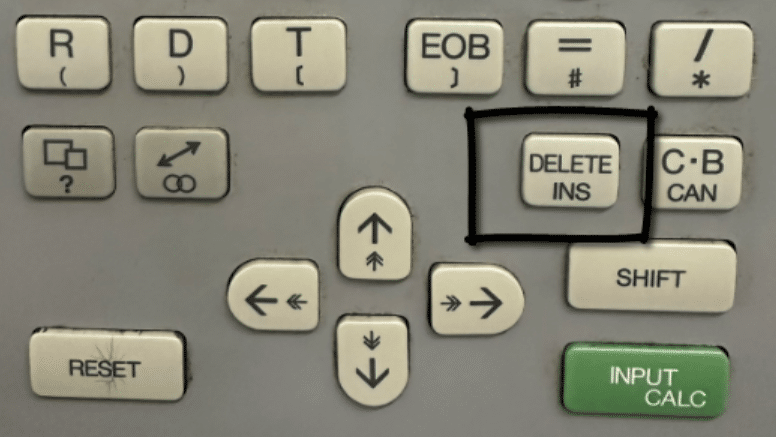

From now on everything you type will be inserted.

**Avoid this key**

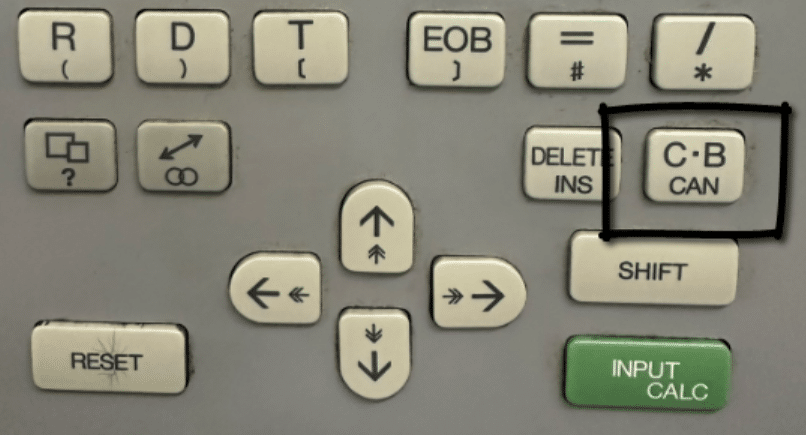

If you press this key it will delete the whole line.

Now if you do this please don’t instantly evacuate your bowels into your underwear. No no no, David is here to help you.

Just press the left hand page key and all will return and the shit storm you just evoked will be forever calmed. Yes you guessed it, it goes back to normal. Lovely.

This means any edit you make will not be permanent until you pres INPUT CALC yes this baby.

So hold off until your happy and keep that camera at the ready.

So my advise is to leave this little chappie alone until you are ready for a permanent commitment.

There is actually no way to copy and paste text which is a shame. (Let me know if you know better)

Adding a description (comment) to your program in the directory page is also easy,

Press EDIT and then soft key FILE

You will now be able to type in the program number then the comment (description) you want to appear on the screen in the directory.

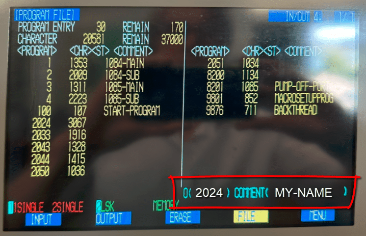

I recommend this on all the programs to avoid getting lost. Only dashes allowed, no spaces.

[Nice video on this](https://youtu.be/w0UbrqL63eY) (how thoughtful)

**Delete Program Mitsubishi 60s**

Again be super careful with this one it’s a one way street to a shit storm. No undo buttons here sorry delete it and it’s gone.

Press DIAG IN OUT then press MENU soft key until you see ERASE.

Key in 1 to delete a main program followed by the number of the program you want to erase. Now when you press INPUT it’s gone forever, gone to deleted program heaven. I did warn you.

## Macro Mitsubishi 60s

I am not going to say too much about programming in this article as it is rather complex.

The programs are constructed around a macro program **O8200** this starts with the line

/G65 P9801 A150. B12. C100. D600 E3. F6. H0. I1 J2591 K0

A=SURFACE-SPEED)

B=BAR-DIA)

C=PART-OVERALL-LENGTH)

E=PART-OFF-WIDTH)

J=PROGRAM NUMBER FOR MACHINING

From all this information it can perform a part off and load new bars etc.

It uses block skip which when off will let it read all the information it needs and do it’s calculation. It will then load a new bar. Then afterwards it will automatically switch the block skip on. It can then run around the loop.

The idea is that you give it all this information then write your program. It then calls this from here as a sub program denoted by the letter J.

This is not my machine but if it were I think I would do away with the macro idea and create a standard program.

I think it is an attempt to simplify what is inherently a complex machine. Anyway my verdict is that it actually makes it more complex.

## How do I Rate Mitsubishi 60s Control?

Well actually I like it although there are one or two built in torture keys like this one  which deletes a whole block of code. Think of it as the cock and balls torture key and you’ll remember not to press it. Ladies I’m afraid you’ll need to create your own acronym.

**Best Bit**

But honestly editing on the fly is amazing and useful too. The times I’ve had to reset a program half way through because I forgot to alter a simple mistake. So the ability to edit a program whilst it is running is brilliant.

By the way you can do this on Mazak machines when you are running them in ISO G code type programs.

Copying programs is really easy and by the way it’s not easy on all machines.

Adding descriptions to programs is really easy so that’s another plus.

**Big Big Plus**

Having used lots of machines that run two sometimes three simultaneous programs. What I like on the Mitsubishi 60s control is that when you create a new program it automatically creates the same program number on channel 2.

Therefore there is never any confusion. On Fanuc machines you can be running a totally different program number on each channel.

On this control it’s not possible because whatever program you call on channel 1 you automatically get on channel 2.

You have to keep in mind that this is an old machine so you can’t expect too much. It also reflects in the price. You have a machine with a six figure price tag when new that you bought for less than 15k.

Once it’s running it’s a fuckin dream to watch and it’s still really fast even by today’s standards.

My advise if you have the work and the bollocks for it then get one, just call me in and we’ll have some fun together getting it up and running.
